# lingo-agent

[](https://github.com/YangD1/lingo-agent/actions/workflows/ci.yml)

[English](README.md) | 简体中文

开源的 AI 英语助手 Agent。目标是做一个这样的助手：记得你是谁，按你的水平调整教什么，用 CEFR 标准评估你，用 FSRS 安排单词复习，给你推送按难度分级的新闻，基于知识图谱回答语法问题，还能和你语音对话。

**技术栈：** FastAPI · LangChain / LangGraph · PostgreSQL + pgvector · Next.js · OpenTelemetry

> **状态：P4 已完成（低配服务器部署除外）。** 助手能对话、记住你、跟踪你的语法、安排单词复习、用 CEFR 给你定级；能出经过 critic 检查的语法练习、批改写作、按你的等级改写新闻，还会诊断你反复出错的语法点的根因，并按你每天的时间排好今天的计划。语音方面，能用服务端的声音朗读、给你的跟读打分、按情景练口语、实时打电话，背单词也能听音辨词和拼写。企业级打磨（P4）也已完成：与成员共享模型和额度、自选助手、用量与成本看板、限流、提示词版本与评估回归，以及可一键灌入的演示账号和[演示脚本](docs/demo.md)。见[现在能做什么](#现在能做什么)。

| | |
|---|---|
|  | 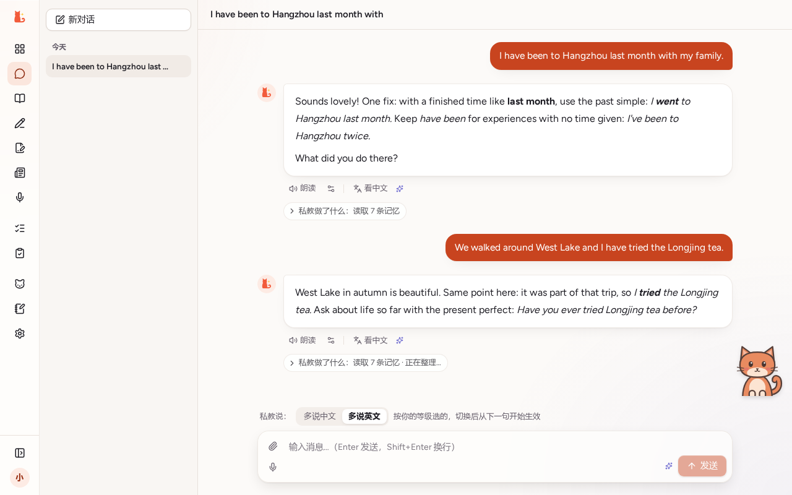 |
| 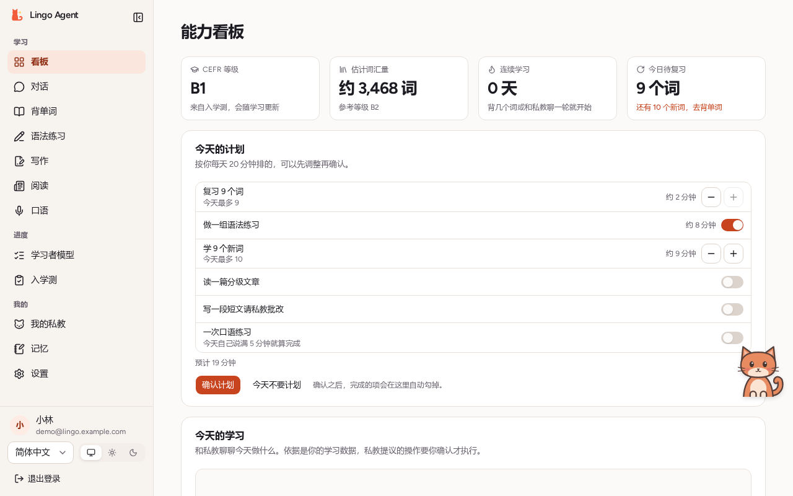 | 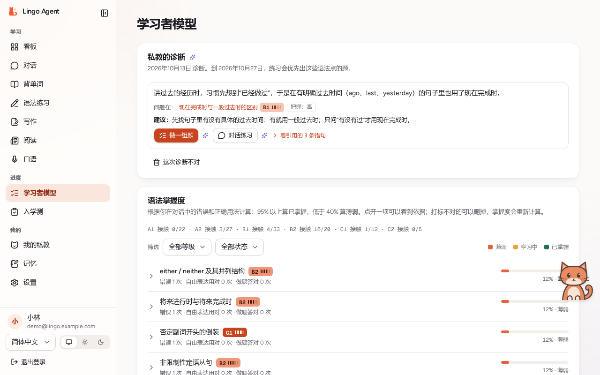 |
| 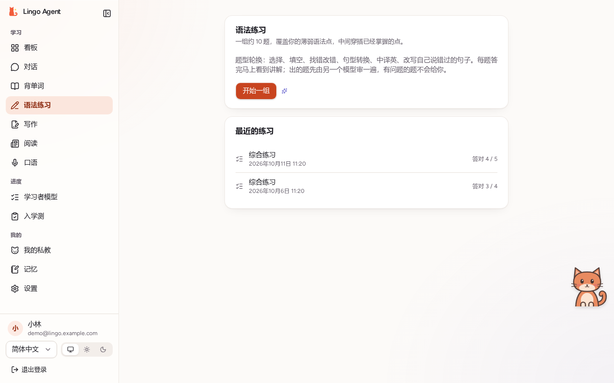 | 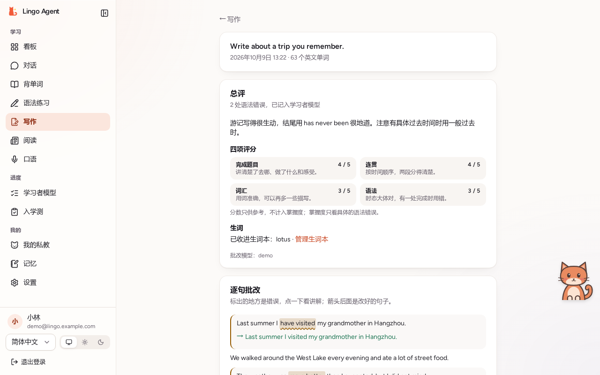 |
| 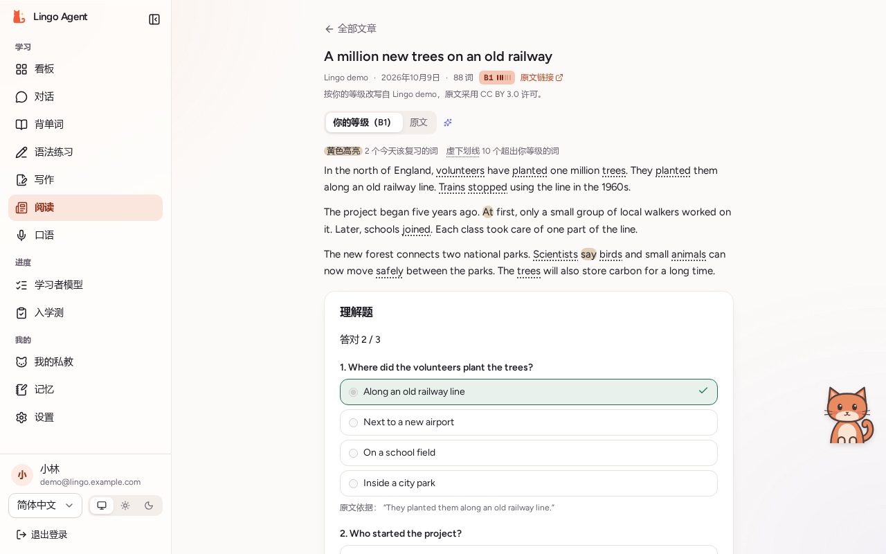 | 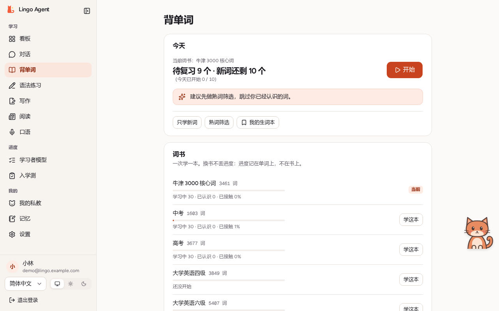 |
| 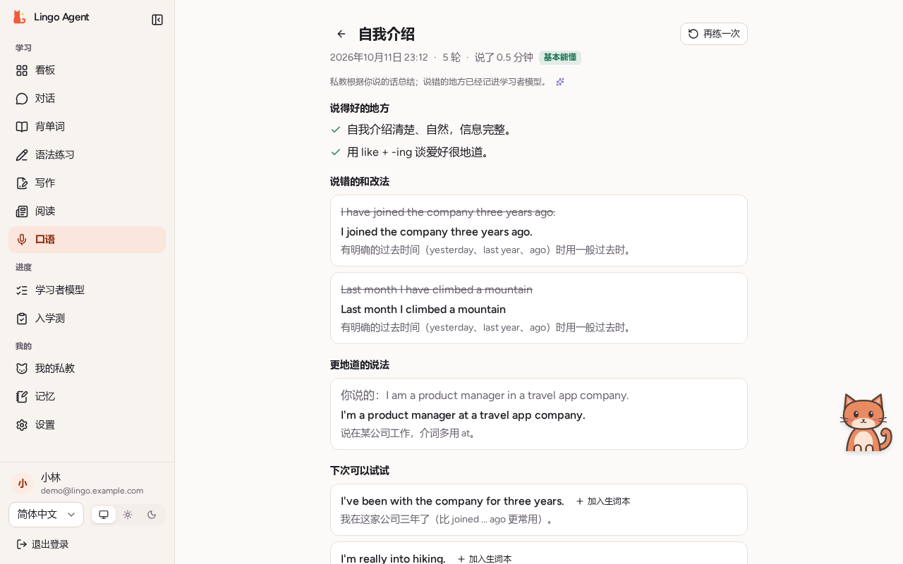 | 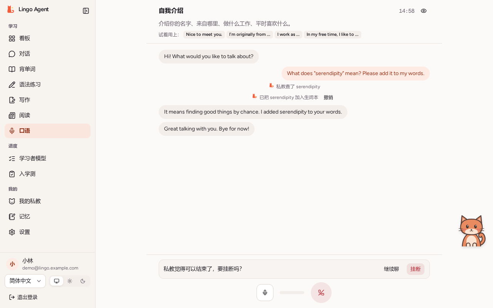 |
| 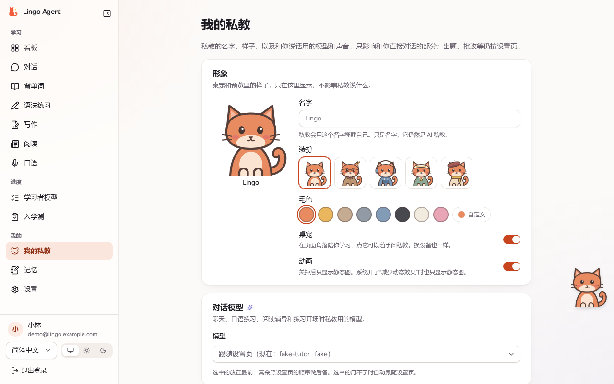 | |

<sub>截图用的是演示账号的学习记录（`make demo-seed`）；只有模型当场写的内容（对话回复、通话）是预先写好的。`make screenshots` 可以重拍。要给别人演示，可以照着[演示脚本](docs/demo.md)走一遍。</sub>

## 现在能做什么

**学习**

- **记得你的助手**：每次回复后，后台会判断哪些值得记住（你的目标、兴趣、反复出现的问题），并给会话写摘要。**记忆**页面列出它记住的全部内容，每一条都可以修改或删除。
- **语法跟踪**：同一个后台步骤会把你的错误标到 119 个语法点上（A1–C2）。掌握度由算法（BKT 和 Elo）根据这些证据更新，不由模型打分。**学习者模型**页面列出每个语法点和背后的证据，每条证据都可以删除。
- **FSRS 背单词**：选一本词书（牛津 3000、中考、高考、四级、六级、考研、雅思、托福、GRE），先筛掉认识的词，再按 FSRS 安排每天的复习。卡片背面按词性列出中文释义，下面是来自 Simple English Wiktionary 的浅显英文义项（各带例句），再下面最多三句来自 Tatoeba 的真实例句（有人工中文翻译的排在前面）；没有真例句的词，接下来一天要复习或要学的会在后台预先写好 AI 例句（可以关），其余的点了才生成。对话里遇到的生词会自动收进生词本。除了翻卡片，复习还可以切到听音辨词（读出单词，从四个释义里选）、拼写（看释义、听发音，输入单词，标出拼错的字母）或混合；对错由代码判，并预选一个评分，你可以改。
- **读得懂助手的话**：输入框上方可以切换“多说中文 / 多说英文”（没选过时按等级：A1–A2 或还没定级时多说中文），从下一句开始生效。助手回复里的英文单词，悬停或点按就能看音标、释义、原形和原句，还可以生成 AI 例句、一键加入生词本。每条回复都能朗读：用浏览器自带的声音，自动挑这台设备上最好的（Edge 的 Natural、Chrome 的 Google、macOS 的 Premium 声音），中英文各用各的声音，逐句读；在**设置 → 朗读**（或朗读按钮旁的齿轮）里可以自己选声音、美音或英音、英文语速，设置存在当前浏览器。部署方配了朗读路由（Azure 语音、阿里云百炼的通义千问 TTS、硅基流动或 OpenAI 等兼容 `/audio/speech` 的服务，或本地 Kokoro）时，回复、单词和复习卡片改用服务端的声音逐句朗读；读过的句子会缓存、不再计费，朗读服务出错时自动换回浏览器的声音。学习者可以在自己的浏览器里关掉服务端朗读，也可以清除为自己生成的录音；30 天没人播的录音会自动删除。部署方还可以在**设置 → 单词发音**里把整本词书的单词发音提前生成好（先看词数、字符数、预计占用和按单价估算的费用，后台分批生成，可暂停、继续，重启后接着跑），学习者点单词朗读时直接播放，不再调用模型。回复也能切换看中文版或英文版，译文保存下来，来回切换不再调用模型。
- **跟读**：助手回复旁、阅读文章每段末尾、复习卡片例句后面都有麦克风，可以先听示范、再录自己读一遍（最长 30 秒）。部署方配了发音评测（Azure 语音，在**设置 → 发音评测**）时，能看到总分和准确度、流利度、完整度（美音还有韵律），每个词按读得好坏着色，点开一个词能看每个音的得分；读不准的词可以一键加入生词本，复习卡片上也会标出来。没配时用语音转写对比，标出漏读和读成别的词，并注明是粗略结果。录音不保存；跟读记录在学习者模型页，可以逐条删除或清空。
- **口语练习**：在“口语”页选一个适合你等级的情景（自我介绍、面试、点餐、问路等），或者自由聊。助手扮演对方、先开口。按住麦克风说话（或点一下开始、再点一下发送；电脑上可以按住空格），说完自动转写并发送，助手的回复边生成边朗读。转写错了可以“改一下”最后一条语音，改好后重新发送。助手不逐句纠错，只顺着把对话接下去；结束后给一份小结：说得好的、说错的和改法、更地道的说法、下次可以试的表达，都可以跟读，表达可以加入生词本。说错的地方计入语法证据，太短、可能听错的语音不算。没配语音转写时可以打字练。
- **实时通话**：部署方配了实时语音路由（OpenAI Realtime、通义千问 Omni Realtime、阶跃 StepFun 或 Gemini Live）时，在“口语”页点**打电话**，就能像打电话一样和助手聊：延迟低、可以打断、有字幕。助手一接通就知道你的等级、目标、记忆和情景；通话中能查词、把词加进生词本（通话界面上看得到，可以撤销）。挂断后，转写文本和普通对话一样进反思（记忆、语法证据、收词），30 秒以上的通话还会生成和口语练习一样的小结。管理员可以设单次通话上限和每人每天的分钟数（默认 15 和 30 分钟，填 0 关闭）。音频由后端转发，不保存。
- **入学测**：大约 10 分钟，最多 40 道词汇题和 20 道语法题，自适应出题，不调用模型。结果会更新你的 CEFR 等级；还可以把词书里你大概率认识的词一次性标为熟词，要先确认，也可以撤销。
- **看板**：词书进度、语法掌握、技能估计、常错语法点和学习打卡，还有“今天的学习”：和助手的对话框。算法挑出值得做的事，作为快捷回复给你；助手和你商量，用卡片提议，你确认才执行。每天一段对话，你发第一条消息时才创建，所以打开看板不调模型。没配模型时显示算法挑的建议链接。
- **今天的计划**：看板上按你每天的学习时间排好今天要做的：到期复习、新词、一组练习、一篇阅读，有时还有一篇写作，并估好时间。计划由算法排，打开看板不调模型。确认前可以调数量、开关某一项；每项都能直接点过去做，做完自动打勾。口语练习是可选的一项：打开后，当天自己说满 5 分钟就算完成。在“今天的学习”里跟助手说“今天只有 10 分钟”，助手会用卡片提一份更轻的计划，确认后替换，也可以撤销。
- **针对语法点的练习**：从看板或学习者模型页面，可以针对某个语法点开一个练习对话。助手会先开场，之后每一轮都围绕这个语法点。
- **语法练习**：在“语法练习”页做一组短题（选择、填空、找错改错、句型转换、翻译、改写自己的句子），题目针对现在最值得练的语法点。模型出题，另一次模型调用（critic）逐题检查后才给你看；能用代码判的答案由代码判，其余由模型批改。每次作答都是掌握度的证据；要在不同的日子都答对，才算学会。题目有问题可以标记。
- **写作批改**：在“写作”页按你的等级选题目、自己写题目或不写题目，写 20–800 个英文单词。批改逐句返回：标出错误（点一下看讲解和语法点），下面是改好的句子；还有四项评分（完成题目、连贯、词汇、语法）和总评。错误记入学习者模型，分数只展示。在对话里贴一段较长的英文作文，会交给写作教练用同样的方式批改，并给出结果页链接。删除一篇写作会连带删除它留下的错误记录。
- **对话旁的工作区**：在对话里粘贴一段长文（或在阅读条上点“在工作区精读”），可以在对话旁边的工作区里打开（从网页、Google Docs、Word 复制的内容会保留标题、列表、表格、粗体和链接，Markdown 也照样显示）：原文、对照或只看译文，滚到哪段翻到哪段，只看原文时也能点某一段单独翻，翻过的段落切换显示时直接复用；点句子看结构和意思，点单词查词，段落可以跟读，选中一段点“问助手”就作为引用发给助手。作文也可以在这里打开：边写边自动保存，可以像写作页一样批改；请助手改稿时，它的修改按词标出差异，逐条接受或不用，每个版本都保留，可以回到旧版本。助手觉得有用时会自己打开工作区，每一轮都能看到打开的文档。桌面上左右并排，平板上工作区盖住对话，手机上是“对话 / 工作区”两个标签；刷新后文档仍然打开。
- **分级新闻阅读**：“阅读”页列出你订阅的来源的新文章：NASA 新闻、Global Voices，以及你自己添加的 RSS 源。打开一篇时按你的等级改写（每个等级只改写一次，之后读缓存；也可以在后台预先改写），附 5 道理解题，每道都经过 critic 检查。任何词悬停或点按都弹出和对话里一样的单词气泡；今天该复习的词黄色高亮，超出你等级的词加虚下划线。答题结果更新阅读能力估计，显示在看板上。可以切换到原文；“就这篇文章问助手”会打开一个能看到这篇文章的阅读教练对话。只给摘要或许可不允许改写的来源原样显示，并链接到原网站。
- **语法诊断**：同几个语法点反复出错时，助手把它们和各自的前置语法点、易混语法点放在一起看，在学习者模型页写一段诊断：可能的根因、依据的原句、该怎么练。诊断点名的语法点两周内在练习里出现得更多。觉得不对可以删掉。有新错误时在后台大约每周跑一次，做完一组练习、新错误够多时也会跑；可以关掉。
- **自己的助手**：在“我的助手”页给助手起名字（默认叫 JOJO，回复下面点它的名字就能改），给 Lingo 猫换 5 套装扮之一、选任意毛色（实时预览），并从你实际能用的模型里选对话模型、每种语言的朗读声音（保存前可试听）、通话模型和声音；不选就跟随设置页。成员只能从主账号借给自己的模型里选。助手会以桌宠的形式待在每页的角落：朗读回复或通话时跟着说话，录音时听，等回复时想，答对或完成今天的计划时跳一下，久不操作就打盹。可以拖到左右任一边、收起成小按钮；点它会弹出小窗，接着最近一次对话随手问。桌宠和动画都能关，也可以随时恢复默认。
- **助手可以代为安排，但要你同意**：对话里，助手可以用卡片提议换词书、设定学习目标或今天的计划。你确认之前什么都不会改，确认后还可以撤销。做完入学测后，可以在结果页直接和助手聊学习规划，把测试结果变成学习计划。

**公开透明**

- **JOJO做了什么**：每条回复下面可以展开，看助手读了什么、调用了哪些工具、回复后记下了什么。所有工具和后台步骤都列在 [docs/agent-tools.md](docs/agent-tools.md)。
- **AI 用量标记**：每个会调用模型的功能旁边都有“AI”标记，点之前就能看到会调用哪些模型任务、每次大约用多少 token。
- **后台工作可以关**：助手在你不操作时做的事（预先出好下一组练习、按你的等级预先改写新文章、为第二天的单词预先写 AI 例句、诊断你的错误）可以在“设置 → 后台任务”里逐项关掉。管理员可以给所有后台调用设每日 token 上限（0 表示全部关闭），你自己点的功能从不受限。定时任务跑在唯一的后端进程里，部署时只跑一个后端实例。

**平台**

- **自带模型**：每个账号在应用里添加自己的模型连接，可以选预设（DeepSeek、Anthropic、OpenAI、通义千问、Groq、硅基流动等），也可以填任意 OpenAI 兼容地址。API key 加密存在数据库里。应用会列出连接提供的模型，你可以按任务排列模型顺序，某个模型出错时自动换下一个。整个连接或者某个功能里的单个模型都可以临时停用，配置保留，随时打开。
- **把模型分给成员用**：在**设置 → 成员**里创建邀请链接（有效 1–30 天，可以限定几个人用）发给别人。成员用你的模型连接，但看不到 key；你按能力给每个成员设每日和每月额度（文本 token、朗读字符、语音转写、发音评测和通话分钟），也可以设新成员的默认额度。成员自己配了连接的能力用自己的，不扣额度。主账号只看得到成员的用量，看不到对话、记忆和学习记录。额度用完时，对话和练习会提示（朗读退回浏览器的声音）；AI 标记会写明这次扣谁的额度。成员随时可以退出，主账号也可以移除成员。
- **聊天附件**：图片（由看图模型读取）；PDF、DOCX、TXT、Markdown 文档（扫描版 PDF 的页面交给看图模型）；在浏览器里录的语音或音频文件（由语音转写模型转成文字）。发送前可以检查、修改提取出来的文字。
- **用量与成本看板**：在“设置 → 用量”里看本期合计、按天趋势图，以及按用途（助手回复、复盘、出题……）、按模型、按成员分组的调用次数、token、错误和分钟数，还有按天的明细表。不内置价格：按模型填上你的服务商单价，看板就会估算费用。学习者在学习者模型页能看到自己本月的用量和额度剩余。
- **限流**：登录连续输错会被暂停一段时间（按 IP + 邮箱、IP、邮箱分别计数），注册和加入码按 IP 限次数，会调用模型的功能按用户限每分钟次数，防止被暴力猜密码或被脚本刷掉模型额度。超限时界面会提示还要等几秒。默认值可以在 `.env` 里改（`RATE_LIMIT_*`，见 `.env.example`）。
- **中英文界面**。

还没做：低配服务器的部署覆盖与备份脚本（P4）。

## 快速开始（Docker）

需要 Docker（含 Compose v2）、`make`、`openssl`，以及用来导入词库（只需一次）的 [uv](https://docs.astral.sh/uv/)。整套服务约占 1.7 GB 内存（Postgres、后端、前端都设了内存上限）；第一次构建镜像要几分钟。

```bash
git clone https://github.com/YangD1/lingo-agent.git
cd lingo-agent
make env   # 生成 .env，并随机生成加密主密钥和 JWT 密钥
make up    # 构建并启动 postgres + 后端 + 前端；数据库迁移自动执行
make vocab-import   # 只需一次：下载并导入词库（约 15 秒）
make sentences-import   # 只需一次，在 vocab-import 之后：导入复习卡片的例句（约 3 分钟）
make senses-import   # 只需一次，在 vocab-import 之后：导入复习卡片的英文义项（约 10 秒）
```

**用预构建镜像运行。** 不想自己构建时，可以用每个版本发布在 Docker Hub 上的镜像（amd64）：用 `git clone --branch v0.2.0 …` 克隆对应版本（compose 文件和 `config/` 来自代码目录，要和镜像版本一致），执行 `make env`，在 `.env` 里设置下面三行，再用 `docker compose pull` 和 `docker compose up -d --no-build` 代替 `make up` 启动。后面的导入步骤不变。

```bash
BACKEND_IMAGE=youngdeezh/lingo-agent-backend
FRONTEND_IMAGE=youngdeezh/lingo-agent-frontend
IMAGE_TAG=0.2.0
```

词库来自 [ECDICT](https://github.com/skywind3000/ECDICT)（MIT 许可，66 MB，固定到某个提交并校验 sha256）。文件保存在 `data/`，其中约 3.8 万个词会被导入：考试词表、牛津 3000、柯林斯星级词和词频前 3 万的词。背单词和入学测都要用到它。可以重复执行。访问不了 GitHub 时，把 `ECDICT_URL` 设为同一文件的镜像地址，或者用 `make vocab-import CSV=path/to/ecdict.csv` 导入本地文件。宿主机上没有 uv 时：先下载文件，再执行 `docker compose cp ecdict.csv backend:/tmp/` 和 `docker compose exec backend python -m app.services.vocab.import_ecdict --csv /tmp/ecdict.csv`。

复习卡片上的例句来自 [Tatoeba](https://tatoeba.org)（[CC BY 2.0 FR](https://creativecommons.org/licenses/by/2.0/fr/)）：每个词最多三句英文句子，有人工中文翻译的排在前面（没有翻译的只显示英文），每句都链接到它在 Tatoeba 的页面。导入约 3 分钟，内存约 800 MB。三个按语言拆分的导出文件（约 27 MB）保存在 `data/tatoeba/`；Tatoeba 每周更新导出，所以导入时打印每个文件的日期和 sha256，不校验固定哈希。要拉取新导出用 `make sentences-import REFRESH=1`，用本地文件用 `make sentences-import DIR=path/to/exports`。没有真例句的词仍然可以点“AI 例句”。宿主机上没有 uv 时：从 <https://downloads.tatoeba.org/exports/per_language/> 把 `eng/eng_sentences.tsv.bz2`、`cmn/cmn_sentences.tsv.bz2`、`cmn/cmn-eng_links.tsv.bz2` 下载到同一个文件夹，执行 `docker compose cp 该文件夹 backend:/tmp/tatoeba`，再执行 `docker compose exec backend python -m app.services.vocab.import_tatoeba --dir /tmp/tatoeba`。

复习卡片上的英文义项来自 [Simple English Wiktionary](https://simple.wiktionary.org)（[CC BY-SA](https://creativecommons.org/licenses/by-sa/4.0/)）：用浅显英文写的释义，按编者给的顺序，带词性、语法标签和例句，每个词最多八个义项，链接到词条页。dump（约 9 MB）保存在 `data/simplewiktionary/`；和 Tatoeba 一样，导入时打印文件日期和 sha256。要拉取新 dump 用 `make senses-import REFRESH=1`，用本地文件用 `make senses-import FILE=path/to/dump.xml.bz2`。没有词条的词照旧显示 ECDICT 的 WordNet 英文释义。宿主机上没有 uv 时：从 <https://dumps.wikimedia.org/simplewiktionary/latest/> 下载 `simplewiktionary-latest-pages-articles.xml.bz2`，用 `docker compose cp` 复制到 `backend:/tmp/`，再执行 `docker compose exec backend python -m app.services.vocab.import_simplewiktionary --file /tmp/simplewiktionary-latest-pages-articles.xml.bz2`。

然后：

1. 打开 <http://localhost:3000>，注册一个账号。
2. 新账号会先进入 **配置引导**，五步都可以跳过：怎么称呼你和讲解语言、接入一个对话模型（选厂商、粘贴 API key 即可，用列出模型来验证，不耗 token；有邀请码也可以直接用别人的模型）、学习目标、给助手起名字、要不要现在做 **入学测**（约 10 分钟，结果页可以直接和助手聊聊）。引导随时可以从设置页或用户菜单再次打开。
3. 进入 **对话** 开始聊天，或者到 **背单词** 选一本词书。只有一个连接时不需要设置模型顺序，会自动使用它的默认模型；转写、朗读、实时语音等在 **设置** 里另配。

`make ps` 查看服务状态，`make logs` 跟踪日志，`make down` 停止服务（数据保存在 Docker volume 里，不会丢）。`make help` 列出所有命令。

> **保管好 `.env`。** 其中的 `CREDENTIALS_ENCRYPTION_KEYS` 用来加密数据库里的 API key：丢了它，已保存的 key 就无法读取，用户只能重新填写。轮换方法见 `make rotate-credentials`。

## 配置模型

API key 不放在 `.env` 或 YAML 文件里，由每个用户在 **设置** 里自己填写。[`config/`](config) 里的 YAML 只定义预设和每个任务的默认模型顺序，由 `.env` 里的 `PROVIDERS_CONFIG` 选择用哪一份。

有四个任务在 **设置** 里有自己的模型顺序：

| 任务 | 用途 | 要求 |
|---|---|---|
| 对话模型 | 回复、练习开场、学习规划对话 | 任意聊天模型；助手的卡片需要模型支持工具调用（不支持时助手只能给链接） |
| 后台整理模型 | 每次回复后的记忆、语法打标和收词 | 任意聊天模型，用小一点、便宜一点的就行 |
| 看图模型（vision） | 读取图片和扫描版 PDF 的页面 | 支持图片输入的模型 |
| 语音转文字 | 转写语音消息和音频文件 | OpenAI 兼容的 `/audio/transcriptions` 接口 |

其他任务使用 `config/` 里的默认模型顺序。对话、后台整理和其他调用都会兜底到各连接的默认模型，所以一个连接就能开始用。看图和语音转文字不会兜底，要单独设置。每个连接的 **测试** 按钮可以选按对话、语音转写或看图来测。如果你有 `config/` 里 embedding 路由指定的连接（默认是 `openai`，用 `text-embedding-3-small`），记忆会按语义检索；否则取最近的几条。

语音转文字最省事的是 Groq 和硅基流动两个预设。Groq 和 OpenAI 会拒绝部分地区（包括中国大陆）的请求；硅基流动（`FunAudioLLM/SenseVoiceSmall`）在大陆可以直接访问。

**用本机上的模型服务（比如 Ollama）**：后端默认拒绝私有网络地址，防止共享的服务器被借道访问它所在的内网（SSRF）。如果这台机器只有你自己用：

1. 在 `.env` 里设置 `PROVIDER_ALLOW_PRIVATE_NETWORKS=true`，再执行一次 `make up`。
2. 添加一个 **自定义** 连接。从 Docker 里访问要填 `http://host.docker.internal:11434/v1`，不能填 `localhost`（在容器里，`localhost` 指的是后端容器自己），同时让 Ollama 监听 127.0.0.1 以外的地址（`OLLAMA_HOST=0.0.0.0`）。如果后端直接跑在宿主机上（见下文），填 `http://localhost:11434/v1`，Ollama 预设可以直接用。

**本地语音转写（可选，开发用）**：`make asr-up` 会在 8200 端口启动 [speaches](https://github.com/speaches-ai/speaches)（faster-whisper），第一次启动会下载模型（容器不走宿主机代理；连不上 huggingface.co 时在 `.env` 里设 `ASR_HF_ENDPOINT=https://hf-mirror.com`，否则容器会一直重启），转写时约占 1.4 GB 内存。然后在允许私有网络的前提下，用 **Speaches** 预设添加连接（Docker 里的后端用 `http://asr:8000/v1`，宿主机上的后端用 `http://localhost:8200/v1`），把 `speaches:Systran/faster-whisper-small` 放进“语音转文字”的模型顺序。详见 [`.env.example`](.env.example) 里的注释。

**本地朗读（可选，开发用）**：同一个容器还能用 Kokoro 朗读。先下载一次模型：`curl -X POST http://localhost:8200/v1/models/speaches-ai/Kokoro-82M-v1.0-ONNX`，再把 `speaches:speaches-ai/Kokoro-82M-v1.0-ONNX` 放进“朗读”的模型顺序。它只能读美式和英式英语（speaches 0.9 不支持中文，中文交给浏览器朗读）。开发机上实测：加载后约占 0.9 GB 内存，两个请求同时来时约 1.5 GB，一句 9 秒的英文约 2 秒合成完。没配朗读路由时由浏览器朗读（ADR 0018）；线上建议用 Azure 语音等托管服务（ADR 0028）。


## 本地开发

除了 Docker，还需要 [uv](https://docs.astral.sh/uv/)（会自动安装 Python 3.12）、Node.js 24 和 pnpm（执行 `corepack enable` 即可得到 `frontend/package.json` 里固定的版本）。

```bash
make env            # 如果还没生成过
make install        # 按锁文件安装后端和前端依赖
make dev-db         # 只启动 postgres，端口 localhost:5433
make migrate        # 执行数据库迁移
make dev-backend    # 后端，:8000，改代码自动重载        （终端 1）
make dev-frontend   # Next.js 开发服务器，:3000           （终端 2）
```

前端会把 `/api` 代理到后端，所以同样打开 <http://localhost:3000>。

测试和检查（需要先 `make dev-db`；测试使用独立的数据库，不会调用真实的模型 API）：

```bash
make test     # pytest（默认 4 个进程并行，PYTEST_WORKERS=0 串行）+ Vitest
make e2e      # Playwright；自己启动后端、前端和一个假模型
make lint     # ruff + mypy、eslint + TypeScript
make fmt      # 格式化并自动修复后端代码
make ci       # 按 CI 的顺序跑一遍 CI 的全部检查
make eval     # 评估集（critic、批改、诊断、口语小结），回放录好的模型回复
make prompts  # 各提示词的版本（文本哈希）；用量记录里会记每次调用用了哪些版本
```

`make eval-live ARGS='--email <账号>'` 改用你某个账号配置的模型跑评估集（加 `--record` 保存新的录制）；它会调用真实 API，要花 token。

CI（[`.github/workflows/ci.yml`](.github/workflows/ci.yml)）在每次推送到 `main` 和每个 pull request 时运行：后端检查、前端检查、Docker 构建和端到端测试。

## 架构

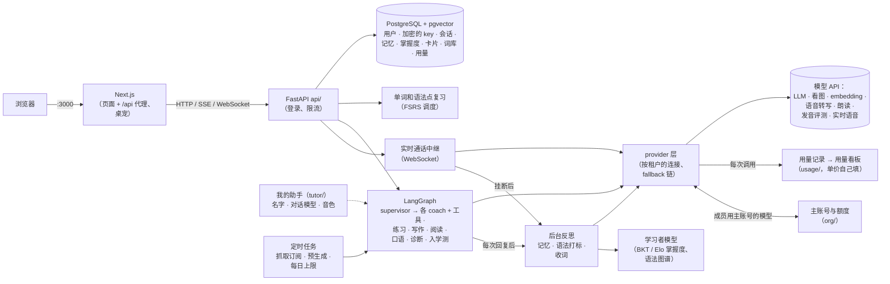

浏览器只和 Next.js 通信；登录 cookie 是 httpOnly 的，请求经同源代理到达后端 API。登录、注册和会调用模型的接口在进程内限流（`ratelimit.py`，[ADR 0035](docs/decisions/0035-rate-limiting.md)）。所有模型调用都经过 provider 层，它根据每个租户自己的连接构建模型，成员则用主账号的连接、在主账号给的额度内调用（[ADR 0031](docs/decisions/0031-org-accounts-and-quotas.md)）；业务代码里不直接创建厂商 SDK 客户端，也不写死模型名。每次调用都记下任务、模型、token 数和提示词版本，用量看板就从这里算（[ADR 0034](docs/decisions/0034-usage-dashboard-and-prices.md)）。“我的助手”让学习者从自己实际能用的里面挑名字、对话模型和音色，只把所选模型挪到链首，别的不变（[ADR 0032](docs/decisions/0032-learner-tutor-choice.md)）。

### 自适应闭环

**LLM 负责理解和生成，算法负责记账和调度。** 模型读懂学习者说的、写的，标出涉及的语法点；出题、改写文章、讲解错误也由模型来做。但掌握度从不让模型打分，什么时候复习也不由模型决定：掌握度由 BKT 和 Elo 根据证据更新，复习由 FSRS 安排，入学测的判分也不经过模型。

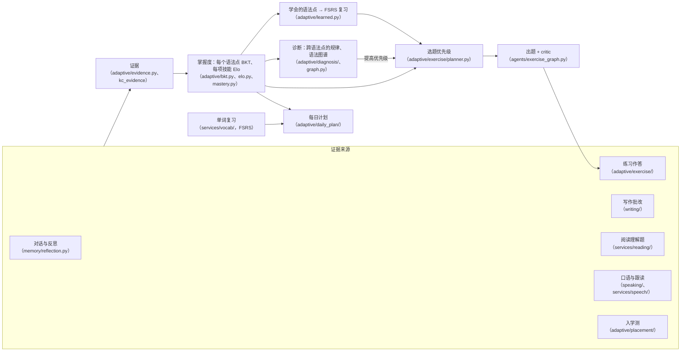

闭环里的数字（BKT 参数、Elo 的 K、选题权重、诊断加成、计划量）都来自 [`adaptive/rules.yaml`](backend/app/adaptive/rules.yaml)，`kc_mastery` 可以通过重放证据重建。单词不走 BKT，按自己的 FSRS 排期（[ADR 0010](docs/decisions/0010-learner-model.md)、[ADR 0011](docs/decisions/0011-vocabulary-and-fsrs.md)）；模型出的题要先过 critic 才会给到学习者（[ADR 0021](docs/decisions/0021-exercise-engine.md)）。

```
backend/app/     FastAPI 应用：api/ 路由，agents/ LangGraph 图（supervisor 和各 coach），
                 providers/ 模型访问，memory/ 长期记忆与反思，
                 adaptive/ 语法点、掌握度、语法图谱、练习组和诊断，placement/，writing/，
                 speaking/ 口语练习，realtime/ 实时通话，services/ 下的 vocab（词书与 FSRS）、
                 news（订阅源）、reading（改写和理解题）、speech（朗读缓存、跟读），
                 scheduler/ 定时任务，cards/ 助手工具，advice/，dashboard/，
                 usage/ 用量记录与看板，org/ 主账号与额度，tutor/ 我的助手，ratelimit.py，
                 attachments/，prompts/，credentials/ key 加密，db/ 模型和迁移
backend/evals/   评估集和录好的模型回复（make eval）
backend/tests/   pytest（单元测试 + 连真实 Postgres 的集成测试）
frontend/        Next.js App Router、shadcn/ui、next-intl；e2e/ 是 Playwright 测试
config/          provider 预设和默认模型顺序（dev / prod）
docs/            decisions/（ADR）、agent-tools.md（全部工具和后台步骤）
```

设计文档：

- [docs/decisions/](docs/decisions)：架构决策记录，比如 [provider 层](docs/decisions/0002-provider-layer.md)、[租户凭据](docs/decisions/0004-tenant-credentials.md)、[附件](docs/decisions/0008-multimodal-attachments.md)、[长期记忆](docs/decisions/0009-long-term-memory.md)、[学习者模型](docs/decisions/0010-learner-model.md)、[词库与 FSRS](docs/decisions/0011-vocabulary-and-fsrs.md)、[agent 工具与公示](docs/decisions/0013-agent-tools-and-disclosure.md)、[AI 用量标记](docs/decisions/0014-ai-usage-disclosure.md)、[确认卡](docs/decisions/0015-tutor-tools-and-confirmation-cards.md)、[练习引擎](docs/decisions/0021-exercise-engine.md)、[语法图谱](docs/decisions/0022-grammar-graph-in-postgres.md)、[supervisor 与各 coach](docs/decisions/0023-supervisor-and-coaches.md)、[阅读来源与版权](docs/decisions/0024-reading-sources-and-copyright.md)、[定时任务与后台上限](docs/decisions/0025-scheduler-and-background-budget.md)、[每日计划](docs/decisions/0027-daily-plan.md)、[语音厂商](docs/decisions/0028-speech-providers-tts-pronunciation.md)、[口语练习](docs/decisions/0029-speaking-practice.md)、[实时语音](docs/decisions/0030-realtime-voice.md)、[主账号与额度](docs/decisions/0031-org-accounts-and-quotas.md)、[用量看板与单价](docs/decisions/0034-usage-dashboard-and-prices.md)、[限流](docs/decisions/0035-rate-limiting.md)

## 部署

这套 Docker 服务的设计目标是能跑在低配服务器上。对外开放之前：

- 设置 `APP_ENV=prod` 和 `PROVIDERS_CONFIG=config/providers.prod.yaml`。prod 模式下登录 cookie 只通过 HTTPS 发送，所以要在 3000 端口前面加一个 HTTPS 反向代理。
- 保持 `PROVIDER_ALLOW_PRIVATE_NETWORKS=false`。
- 只有前端端口对外；Postgres 和后端只监听 127.0.0.1。
- 按 IP 的限流从 `X-Forwarded-For` 取客户端地址。Next 会把浏览器带来的这个头原样转给后端，所以前面的反向代理必须用真实地址覆盖它（Caddy 默认就会这样做），否则按 IP 的限流可以被绕过（见 [ADR 0035](docs/decisions/0035-rate-limiting.md)）。
- 后端每两小时抓一次阅读来源。服务器网络连不上某些来源时，设置 `FEED_HTTP_PROXY`（compose 里的后端用 `COMPOSE_FEED_HTTP_PROXY`）；它只用于抓 RSS，对地址的检查比直连宽松（见 `.env.example`）。

## 参与贡献

欢迎提 issue 和 pull request。提 PR 前请先跑一遍 `make ci`，提交信息使用 [Conventional Commits](https://www.conventionalcommits.org/zh-hans/)（`feat:`、`fix:`、`docs:` 等）。

## 许可证

[MIT](LICENSE)

运行时用到的数据由导入命令下载，不包含在仓库里：词库来自 [ECDICT](https://github.com/skywind3000/ECDICT)（MIT），例句来自 [Tatoeba](https://tatoeba.org)（[CC BY 2.0 FR](https://creativecommons.org/licenses/by/2.0/fr/)），英文义项来自 [Simple English Wiktionary](https://simple.wiktionary.org)（[CC BY-SA](https://creativecommons.org/licenses/by-sa/4.0/)）。

阅读文章由后端从 RSS 抓取，只存在你自己的数据库里：[NASA 新闻](https://www.nasa.gov/news-release/feed/)（美国政府作品，公有领域；跳过“每日天文图”APOD）和 [Global Voices](https://globalvoices.org)（CC BY 3.0；跳过从合作方转载的文章）。学习者自己添加的源只在添加者所在的租户里显示。
